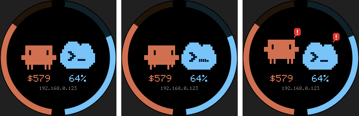

# ClaudeCodeIndicatorRound

Firmware for the **ESP32-2424S012**: an ESP32-C3 board with a 1.28" 240×240 round GC9A01
display. You can buy it with or without touch; touch isn't used.



- **Left half ring:** Claude usage budget left, in orange. **Right half ring:** Codex budget
  left, in light blue. Each ring drains from the top down as the budget is spent, and goes
  dim when there's no reading.
- **Centre:** Clawd (Claude Code's pixel crab) and the Codex cloud with its `>_` prompt face.
  Each one is animated by its own state:

  | State | Clawd | Codex |
  |---|---|---|
  | idle (`done`) | stands still, blinks now and then | floats gently, cursor blinks |
  | working | scuttles side to side, legs walking, eyes looking where it goes | bobs and "types" after the prompt |
  | waiting for you | hops with arms up, red `!` bubble | hops, prompt squints, red `!` bubble |

- **Below the avatars:** dollars left for Claude and percent left for Codex. The bottom line
  shows `WIFI...` while connecting, then the board's IP for one minute.

The avatars are pixel-art takes of the two tools. Clawd follows `claude_full.png` and the
Claude Code welcome banner. The Codex CLI has no official mascot, so its avatar borrows the
cloud shape of the Codex app icon and adds a terminal-prompt face. To change how they look,
edit `render.h`.

## Flashing

Step-by-step guide with troubleshooting: [UPLOAD.md](UPLOAD.md). Short version:

1. Boards Manager: install **esp32** by Espressif.
2. Library Manager: install **GFX Library for Arduino** (Arduino_GFX, by moononournation).
3. Set Board to **ESP32C3 Dev Module**, USB CDC On Boot to **Enabled**, and Flash Size to
   **4MB**.
4. Copy `secrets.example.h` to `secrets.h` and fill in your Wi-Fi details.
5. Flash the board. Read the IP off the screen and enter it in the tray app under **Set ESP32
   address…**.

The pins come from community posts for this board: SCLK 6, MOSI 7, DC 2, CS 10, backlight 3,
no reset line. If the screen stays dark, check them against your board. Use `ROTATION` to
turn the image so the USB-C port faces where you want it, and `BRIGHTNESS` to set the
backlight level.

## What the tray app sends

```
GET /state?value=<working|waiting|done>&rgb=<hex>
          [&spent=<usd>&limit=<usd>]        Claude usage credits (/usage)
          [&codex=<working|waiting|done>]   Codex state, from Codex hooks (below)
          [&cused=<0-100>]                  Codex usage, percent used
```

`cused` uses the workspace credit limit when there is one. Otherwise it uses whichever of
the 5h and weekly windows is fuller. The matrix firmware ignores the Codex fields.

## Codex state (optional): Codex hooks

The tray app installs Claude Code's hooks itself. Codex has to be told about the tray app by
hand. Without these hooks, the Codex avatar stays idle, but its usage ring still works.

The tray app listens on `/codex/working`, `/codex/waiting` and `/codex/done`. Add the
following to `~/.codex/hooks.json`, or the equivalent `[hooks]` tables in `config.toml`:

```json
{
  "hooks": {
    "UserPromptSubmit":  [{ "hooks": [{ "type": "command", "command": "curl -s -m 2 -X POST http://localhost:8787/codex/working" }] }],
    "PreToolUse":        [{ "hooks": [{ "type": "command", "command": "curl -s -m 2 -X POST http://localhost:8787/codex/working" }] }],
    "PostToolUse":       [{ "hooks": [{ "type": "command", "command": "curl -s -m 2 -X POST http://localhost:8787/codex/working" }] }],
    "PermissionRequest": [{ "hooks": [{ "type": "command", "command": "curl -s -m 2 -X POST http://localhost:8787/codex/waiting" }] }],
    "Stop":              [{ "hooks": [{ "type": "command", "command": "curl -s -m 2 -X POST http://localhost:8787/codex/done" }] }]
  }
}
```

Then open `/hooks` in Codex and trust the hooks, because Codex skips hooks it doesn't trust.
`curl` ships with Windows 10 and later.

These hooks are untested. Codex hooks became stable in v0.124, but some third-party guides
say they are disabled on Windows. Check the current
[Codex hooks docs](https://developers.openai.com/codex/hooks) if nothing happens.

## Previewing without hardware

`tools/preview.cpp` compiles the same `render.h` on a PC and writes PPM frames for each state:

```
g++ -O2 -std=c++17 -o preview tools/preview.cpp && ./preview out/
```
